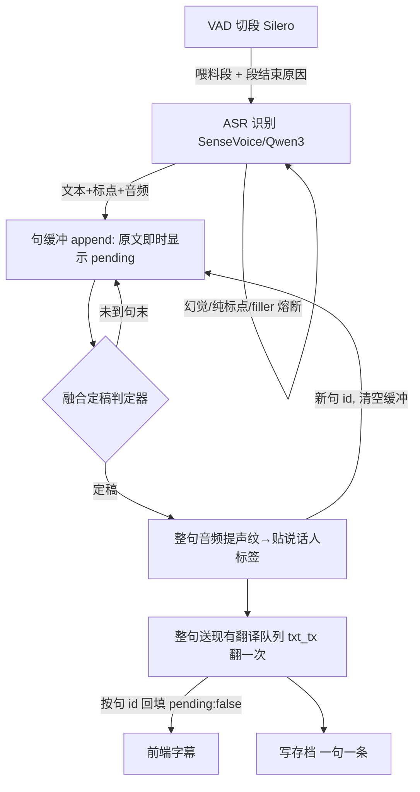

# 实时精确断句（攒句定稿）· 设计方案

> 状态：**设计稿（待评审）**，尚未实现。本文件是最终方案的定型蓝图，评审通过后再动代码。
> 实现落地时须同步更新 [AGENTS.md](../AGENTS.md)（架构章节）与分发入口。
>
> 方案演进说明：早期草案曾用 re-translation（边说边重译刷新译文）。评审后确认核心诉求是**精确断句**，
> 不需要译文实时逐字刷新，故降级为更简单、对既有系统冲击更小的**「攒句 + 句末翻一次」**（路径1）。
> re-translation 保留为可选未来升级（见 §9）。

## 0. 一句话概述

把翻译/落盘/贴标签的**基本单元从「VAD 段」改为「完整句」**：VAD 段降级为「喂料」，在识别之后、翻译之前新增一层「**句缓冲 + 融合定稿判定**」。攒够一句（判定句末）才把整句送翻译**一次**（复用现有并发翻译队列），并对整句音频提一次声纹贴说话人标签。识别不变（SenseVoice / Qwen3 不动），**不引入重译**。

目标：根治碎片乱译、翻译丢上下文、说话人裂号，把「6s 硬切」从「制造碎片的元凶」降级为「无害的喂料动作」——**且对既有并发/通道/id 等机制冲击最小**。

---

## 1. 背景：现在为什么会出问题

当前流水线（见 [pipeline.rs](../src-tauri/src/pipeline.rs)）：

```
VAD 切段(Silero) → ASR 识别(SenseVoice/Qwen3) → 【每段独立翻译，当最终字幕】
```

**根因：VAD 段 = 翻译单元 = 终态字幕。** 段与段之间无累积、无「定稿」概念。实测问题：

| 现象 | 机制 | 证据 |
|---|---|---|
| `います。→ 有人在` 碎片乱译 | 词尾被 VAD 切成独立段，孤立翻译缺上下文 | 存档 `2026-07-08` 会话 |
| 8.2–8.5s 段拦腰断句 | VAD 撞时长上限（`silero_max_s`）硬切，切点不在句末 | 存档大量 8.2s/8.49s 段 |
| 翻译不连贯 | 每段独立翻，无跨段上下文 | — |
| 说话人裂号（一场 26 个号） | 每段独立聚类 + 碎行逐个归号，声纹短不稳 | 存档 `2026-07-08_101407`：主持人裂成 8/9/14/17/… |

**关键洞察**：断句发生在**识别之前**（先切段再识别），所以 ASR 出的标点**根本没机会参与断句**。要精确断句，必须在**识别之后、翻译之前**新增一层「用文本 + 声学信号把碎段重组成完整句」的逻辑——这层当前不存在。

---

## 2. 断句信号与方案选型（调研结论）

### 2.1 断句信号：三类，融合才精确

「一句话说完了没」没有单一完美模型，本质是三类信号融合：

| 信号 | 来源 | 强 | 盲 |
|---|---|---|---|
| 停顿（声学） | VAD Silero | 简单零成本 | 不懂语义；犹豫误断、快语漏断 |
| 韵律（声学：语调/语气） | Turn 检测模型（Smart Turn） | 懂「语气上说完没」 | 需静音触发；不看文本 |
| 语义/语法完整（文本） | ASR 标点 / 标点恢复 / LLM | 懂句子结构完整 | 要先识别；标点可能不准 |

### 2.2 候选对比（约束：实时 / CPU / 进程内 Rust / 可商用 / **中日英**为主，至少保证中、日、英三语可用）

| 方案 | 信号 | 断句精度 | 中日英 | 进程内/依赖 | 许可 | 结论 |
|---|---|---|---|---|---|---|
| VAD 固定停顿 + 硬切（现状） | 停顿 | 差（碎片源） | ✅ | ✅ | ✅ | 被替换 |
| **VAD + 句末标点**（ASR 自带） | 停顿+文本 | 好 | ✅ 三语 ASR 均出标点（日语句号已实测；中英需实测确认） | ✅ 零新增 | ✅ | **采用（L1 主力）** |
| **VAD + Smart Turn v3** | 停顿+韵律 | 很好 | ✅ 23 语含中日英韩 | ⚠️ 加 8MB onnx + ort 依赖 | ✅ BSD-2 | **采用（L2 补盲，可选）** |
| VAD + LiveKit Turn Detector | 停顿+韵律 | 很好 | ✅ | ❌ <500MB RAM、Py/HF | ⚠️ LiveKit Model License | 排除（许可+体积） |
| VAD + sherpa 标点恢复 | 停顿+文本 | 好 | ❌ 仅中英，**缺日语** | ✅ 复用 sherpa | ✅ | 排除（三语里缺日语） |
| VAD + LLM 判完整性 | 停顿+语义 | 最强 | ✅ 任意 | ✅ 复用翻译 LLM | ✅ | 排除出主方案（时序滞后、边际低）；仅用于「超长兜底切点」 |

来源：[Smart Turn](https://github.com/pipecat-ai/smart-turn)、[LiveKit turn-detector](https://github.com/livekit/agents/tree/main/livekit-plugins/livekit-plugins-turn-detector)、[sherpa punctuation](https://k2-fsa.github.io/sherpa/onnx/punctuation/index.html)、re-translation 范式 [Google ICASSP 2020](https://arxiv.org/abs/1912.03393)。

### 2.3 最终选型：L1 主力 +（可选）L2，分级、只赚不亏

- **L1（标点 + 停顿 + 说话人切换 + 超长兜底）**：确定有效的地基，对规整语音（新闻/会议/播报）足够。**零新依赖。**
- **L2（Smart Turn 韵律，可选）**：补 L1 盲区——无标点/标点错的**快语、口语、犹豫**。以「融合投票」接入，判不准时退化到 L1 安全网，**不比纯 L1 差**。
- **L3（LLM）不作定稿主力**；仅在「超长兜底被迫切」时用文本找最近句边界。

---

## 3. 核心架构（路径1：攒句定稿，不重译）

### 3.1 概念模型

- **喂料段（feed segment）**：VAD 切出的语音段（含 6s 硬切段）。只是原料，**不再等于翻译单元**。
- **句缓冲（sentence buffer）**：累积文本 + 累积音频 + 起止时间 + 一个句 id。原文随喂料段即时追加显示（`pending`）。
- **定稿（commit）**：判定「这句说完了」→ 整句音频贴说话人标签 → 整句送翻译一次 → 回填译文（`pending:false`）→ 写存档 → 清空缓冲、开下一句。

### 3.2 数据流（入站：听→字幕）



**与现在的最小差异**：识别之后、送翻译之前，插入「句缓冲 + 定稿判定」。定稿后的整句，**照走现有翻译队列（`txt_tx` + 2-worker 并发）**，通道/并发/回填机制不变，只是送翻译的**单位从段变句、时机从每段变每定稿句**。

### 3.3 融合定稿判定器（本方案的心脏）

每个喂料段识别完进入缓冲后，跑一次判定。**优先级投票**，任一命中即定稿：

```
1. 段末有可信句末标点(。！？.!?)  且  该段不是「硬切结束」        → 定稿   [L1 主力]
2. 说话人切换(整段声纹与当前句缓冲不同)                          → 定稿   [L1 硬信号]
3. (可选L2) 无标点/标点存疑，但 Smart Turn 在静音点判 turn 结束    → 定稿   [L2 补快语]
4. 长停 ≥ commit_silence_ms(默认 1000ms)                        → 定稿   [L1 安全网]
5. 句缓冲时长 ≥ sentence_max_s(默认 25s)                        → 强制定稿 [兜底]
       └─ 强制切点：在已识别文本里找最近句边界(标点/词界)，而非按长度盲切
否则 → 继续累积
```

**关键设计：标点可信度绑定「段结束原因」。** SenseVoice 会给硬切半句也硬加句号（假句末）。故规则 1 要求「段不是硬切结束」——需 segmenter 输出段时附带 `EndReason { Silence | MaxLen }`（见 §5.1）。

**为什么 L2 只赚不亏**：Smart Turn 只在「标点判不了」时作为额外一票；判对→多救回快语句，判错→落到规则 4、5 安全网，退化成纯 L1。不存在「集成后没用要回退」的返工。

### 3.4 翻译：定稿句翻一次（不重译）

- 定稿的完整句 = 一个独立翻译任务 → `send_tr(句id, 整句文本, speaker)` → 现有 `txt_tx(32)` → 2-worker 并发翻译 → 按句 id 回填。
- 上下文：`CONTEXT_USE` 从「最近成功段」改为「最近定稿句」（语义更干净，句本就完整）。
- M1 的「首译流式 + 疑似未翻重译」保留（那是单次翻译内部的逻辑，与攒句正交）。
- **无 re-translation**：一句只翻一次，翻译量甚至比现在少（不翻碎段/filler）。

### 3.5 说话人分离：整句贴标签

- 定稿时对**整句音频**（累积的喂料段音频拼接）提**一个** CAM++ 声纹（复用 [voiceprint.rs](../src-tauri/src/voiceprint.rs) 的 `Extractor.embed`），经 `SpeakerRegistry` 归一个全局号，整句一个标签。
- **不句内切多行、不依赖 token 时间戳、不需 pyannote 句内分段**。
- 收益：**SenseVoice / Qwen3 通用**（Qwen3 无时间戳，现在完全不能分离，本方案让它也能贴标签）；声纹更长更稳 → **根治裂号**。

### 3.6 入站 / 出站（本方案让两者更对称）

- **入站**（听→字幕）：攒句 → 定稿 → 翻译 → 显示。
- **出站**（说→TTS 回灌）：攒句 → 定稿 → 翻译 → TTS 合成播放。**天然就是 commit-then-speak**（不需要额外为 TTS 的「不可修订」特殊处理，因为本就是句末才翻）。
- 相比 re-translation 方案，路径1 让入站/出站**都是「攒句定稿」同一套逻辑**，对称性更好，`pipeline::start` 的复用结构基本可保留。

---

## 4. 效果与边界（诚实标注）

### 4.1 能解决

| 问题 | 结果 | 机制 |
|---|---|---|
| 碎片乱译（`います`） | ✅ 根治 | 碎段累积成句，永不孤立翻 |
| 6s 硬切拦腰断句 | ✅ 根治 | 硬切段降级为喂料被重组；6s 不再是定稿点 |
| 翻译丢上下文 | ✅ 根治 | 整句翻 + 已定稿句作上文 |
| 说话人裂号 | ✅ 大幅缓解 | 整句归一次号，声纹更长更稳 |

### 4.2 残留盲区（所有非流式方案的共同天花板）

| 盲区 | 说明 | 缓解 |
|---|---|---|
| **抢话**（A 尾 + B 头落同一 VAD 段，无停顿） | 整段提一个声纹必混，归属错 | 靠「说话人切换即定稿」接住有停顿部分；无停顿部分无解（需流式说话人跟踪，sherpa 无） |
| **连珠炮无信号**（连说 25s+，无停顿/无标点/无静音给 Smart Turn） | 三类断句信号全失效 → 超长兜底被迫切一刀 | 从「每 6s 碎」压成「每 25s 最多一次，且切在文本句边界」；现实中零句法边界的连续说话几乎不存在 |

### 4.3 代价（相比现状）

- **译文延迟略增**：从「段末出译文」变「句末出译文」（句比段略长）。但**原文仍即时滚动显示**（每个喂料段识别出就追加原文），体感与现在接近（原文即时、译文稍后），换来译文不碎、完整、准确。
- 无 re-translation 的性能顾虑（不串行重译、不改并发）。

---

## 5. 对既有系统的影响与兼容性（评审重点）

> 路径1 的最大优点：对既有精心设计的机制冲击**小**。逐条评估。

| 机制 | 影响 | 兼容/改造策略 |
|---|---|---|
| **翻译并发**（`NUM_TRANSLATORS=2` 抢锁） | 🟢 **保留不变** | 定稿句是独立翻译任务，照走 2-worker 队列。不像 re-translation 需要串行 |
| **有界通道**（`txt_tx=32` 溢出丢弃） | 🟢 基本不变 | 句→翻译仍一对一；只是 send 时机从每段变每定稿句。`seg_tx` 不变 |
| **id 回填**（`NEXT_SUBTITLE_ID` 单调） | 🟡 小变化 | 从「每段一 id」变「每句一 id」；攒句期间用同一句 id 刷新原文、定稿回填译文。前端 `findIndex` 天然兼容；Overlay 迟到帧守卫（`id<prev.id`）对句 id 仍成立 |
| **双向流水线对称性** | 🟢 **更对称** | 入/出站都变「攒句定稿」，出站天然 commit-then-speak，`pipeline::start` 复用结构基本保留 |
| **ASR 幻觉熔断**（重复/filler/纯标点/模板泄漏） | 🟡 保留在**喂料段级** | 识别后、入缓冲前判；幻觉段直接丢弃不进句缓冲，避免污染 |
| **存档 schema** | 🟡 落盘单位段→句 | 每定稿句一条（含 speaker）；`read_session` 需兼容旧「段级」jsonl（格式相同，仅粒度变，天然兼容）；摘要/历史回看/`retranslate` 输入变完整句，质量提升 |
| **热切目标语言**（`live_target`） | 🟢 兼容 | 定稿翻译时读一次；句跨语言切换取定稿时刻值 |
| **出站门控**（`MIC_GATE_RMS`+声纹门） | 🟢 兼容 | 在喂料段级判，累积过门的段进句缓冲 |
| **代际守卫**（`PIPELINE_GEN`） | 🟢 不冲突 | 保留 |
| **前端「最近 200 条」** | 🟢 兼容 | 条数只减（句<段） |
| **M1 流式翻译 / 回灌防回环 / 设置持久化** | 🟢 兼容 | 不受影响 |
| **camelCase 三处对齐** | 🟡 新增参数需对齐 | 见 §6 |

### 5.1 新增组件（净增量，不破坏现有）

1. 句缓冲状态机（文本+音频累积 + 句 id）。
2. 融合定稿判定器。
3. segmenter 输出 `EndReason { Silence | MaxLen }`（供定稿器判标点可信度：硬切结束的段标点不可信）。
4. 定稿时整句提声纹贴标签（保留句音频缓冲）。

**性能**：无 re-translation 的串行/重译问题；翻译总量**未必增加甚至减少**（不翻碎段/filler，一句翻一次）。

---

## 6. 关键参数与默认值（初稿，实现时可调）

| 参数（camelCase 三处对齐） | 默认 | 含义 |
|---|---|---|
| `commitSilenceMs` | 1000 | 长停定稿阈值（规则 4） |
| `sentenceMaxS` | 25 | 句缓冲超长强制定稿（规则 5） |
| `smartTurnEnabled` | false | L2 开关（阶段 2 实现后可开） |
| VAD `silero_max_s`（现有） | 6 / 10 | 喂料段上限（沿用，语义变为纯喂料） |
| VAD `silero_min_silence_s`（现有） | 0.5 | 喂料段切分停顿（沿用） |

---

## 7. 分阶段实现（同一套设计，分步落地，不返工）

- **阶段 1（L1，零新依赖，核心）**：句缓冲 + 融合定稿器（标点 + 段结束原因 + 长停 + 说话人切换 + 超长兜底切句边界）+ 定稿句翻一次 + 整句声纹贴标签。入站先行、跑通验证，再改出站。**这一步即根治碎片、丢上下文、裂号。**
- **阶段 2（L2，可选）**：接入 Smart Turn v3 作为定稿器可插拔一票（规则 3）。实测广播效果后决定是否默认开。
- **阶段 3（不做，除非必要）**：LLM 完整性仅用于超长兜底切点优化。

---

## 8. 依赖与风险

### 8.1 Smart Turn v3（阶段 2 才引入）
- Whisper-Tiny backbone，~8M 参数，CPU int8 **8MB**，~10ms，23 语含中日韩英，**BSD-2 可商用**，audio-native。
- 用法：Silero 静音时触发，对当前句音频（≤8s）判 turn 是否结束。
- **与 6s 硬切的关系**：6s 硬切是「连续说话撞上限被强切」，那个点**没有静音**，Smart Turn 不在此触发、也无需判断（人还在说）；硬切段只喂料不定稿，等句末（出现静音）时才由标点 / Smart Turn 判定。因此「6s 硬切」在本方案下不再造成断句问题。
- **代价**：官方 Python/HF，进 Rust 需 ONNX + `ort` crate，**引入一份额外 onnxruntime 依赖**（不复用 sherpa 那份）；8MB 可打包。
- **风险**：训练于「人机对话」，用于「旁听广播」效果需实测——但融合投票下只赚不亏。

### 8.2 通用风险与回退
- 译文延迟略增（句末出）：可接受；原文仍即时。
- 句缓冲状态机复杂度：阶段 1 入站先验证再改出站。
- 全程保留「关闭攒句、回退旧段级模式」开关，降级安全。

---

## 9. 可选未来升级：re-translation（译文实时刷新）

若将来希望译文也**边说边逐字刷新**（而非句末才出），可在句缓冲之上叠加 re-translation：每次喂料段增长就重译当前缓冲、按句 id 刷新译文。

**代价**（故本期不做）：同一句多次重译 → 必须串行 → 翻译并发度降为 1、通道语义变多对一、字幕跳变。属独立上层，不影响路径1 的断句正确性。

---

## 10. 待评审决策点

1. 阶段 1 默认参数（`commitSilenceMs` / `sentenceMaxS`）是否合适，需真机调。
2. 是否默认启用 L2（Smart Turn）——取决于阶段 2 广播实测。
3. 句内多说话人切分（本方案放弃、只整句贴标签）是否有必须支持的场景。
4. 译文「句末才出」的延迟是否可接受（默认认为可接受；不接受再上 §9 re-translation）。
5. **中、英**断句的句末标点可靠性需真机实测（**日语已验证**；中英是本期明确要保证的目标语言）。若某语言 ASR 标点不稳，靠 L1 的长停/超长兜底 +（可选）L2 Smart Turn 兜底——三语均在 Smart Turn 的 23 语覆盖内。

---

## 附：术语

- **VAD**：语音活动检测（Silero），只切段不认字。
- **ASR**：语音识别（SenseVoice / Qwen3），认字不切段。
- **喂料段**：VAD 切出的语音段，攒句的原料。
- **句缓冲 / 句**：翻译与定稿的基本单元，由多个喂料段累积而成。
- **定稿 / commit**：判定一句说完，贴标签、翻译、写盘、清缓冲。
